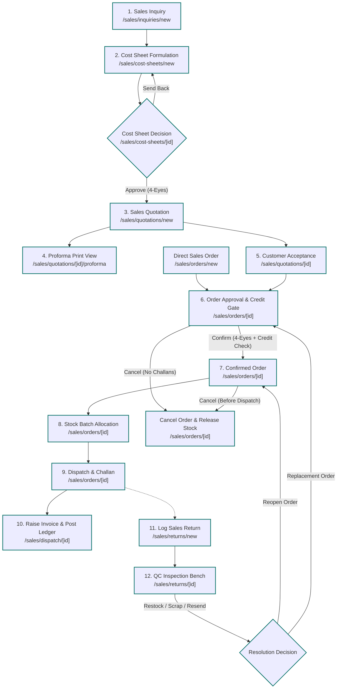
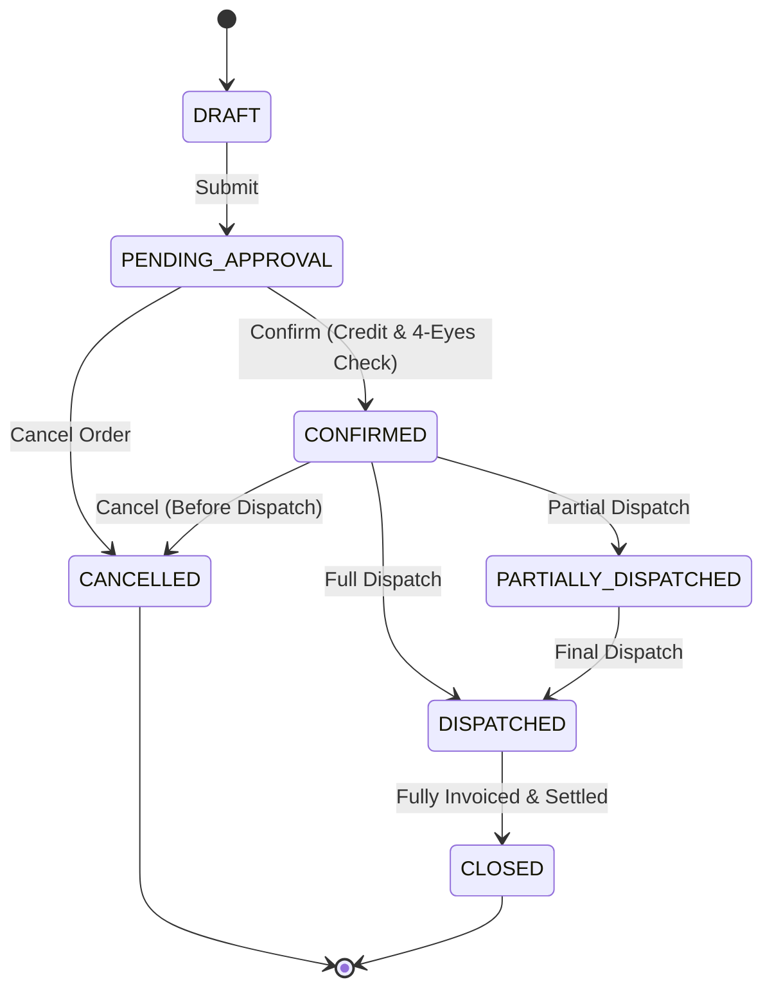
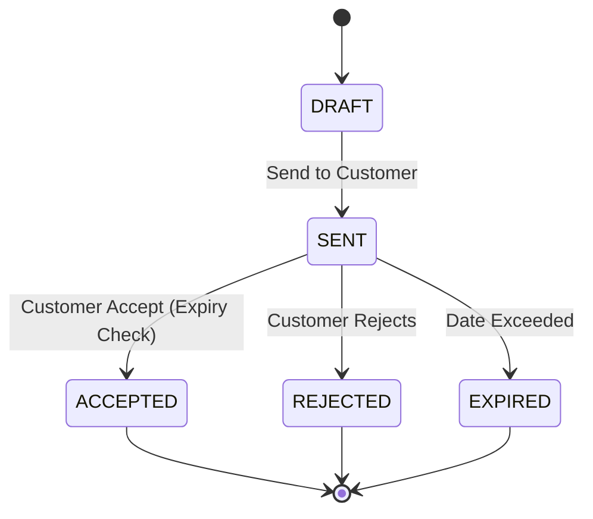
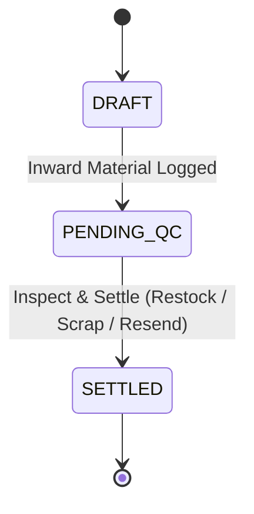

# Sales Module User Flow

## 1. Overview
The Sales module manages the quote-to-cash lifecycle for custom polymer compounds, spanning inquiry capture, cost estimation, commercial quotation, credit-gated order processing, inventory allocation, dispatch challaning, and automated ledger invoicing. It enforces governance rules including four-eyes approvals, margin protection, customer credit exposure gates, and batch traceability. It also handles customer returns with QC inspection and automated stock restoration or replacement order re-triggering.

## 2. Main Flow

## 3. Step Table

| Step | URL | Who (Permission) | Rule or Guard Enforced | Result / Status Change |
| :--- | :--- | :--- | :--- | :--- |
| **1. Create Inquiry** | `/sales/inquiries/new` | Sales (`sales:write`) | Requires customer selection and at least one item line with quantity > 0. | `SalesInquiry: OPEN` |
| **2. Prepare Cost Sheet** | `/sales/cost-sheets/new` | Sales (`costsheet:write`) | Pulls active formulation PHR & raw material rates; calculates conversion, overhead, and margin. | `CostSheet: PENDING_APPROVAL` |
| **3. Decide Cost Sheet** | `/sales/cost-sheets/[id]` | Finance (`costsheet:approve`) | **4-Eyes Guard**: Preparer cannot approve own sheet (`preparedById != userId`). | `CostSheet: APPROVED` or `DRAFT` (sent back) |
| **4. Create Quotation** | `/sales/quotations/new` | Sales (`squote:write`) | **Rate Floor Guard**: Quoted rate must be $\ge$ approved cost sheet selling rate or project target price. | `SalesQuotation: DRAFT` / `SENT` |
| **5. Proforma View** | `/sales/quotations/[id]/proforma` | Sales (`squote:read`) | Available for any active quotation not in `REJECTED` or `EXPIRED` status. | Clean printable commercial document |
| **6. Accept Quotation** | `/sales/quotations/[id]` | Sales (`so:write`) | **Expiry Guard**: Rejects if current IST time > `validUntil` end-of-day. Cost sheet must be approved. | `SalesQuotation: ACCEPTED`, creates `SalesOrder: PENDING_APPROVAL`, sets linked inquiry to `WON` |
| **Direct Order** | `/sales/orders/new` | Sales (`so:write`) | Creates SO directly for existing customer with compound line items. | `SalesOrder: PENDING_APPROVAL` |
| **7. Confirm Order** | `/sales/orders/[id]` | Management/Admin (`so:approve`) | **4-Eyes Guard**: Creator cannot confirm own order (`raisedById != userId`). **Credit Gate**: Rejects if total exposure > credit limit unless override justification is provided. | `SalesOrder: CONFIRMED` |
| **8. Allocate Stock** | `/sales/orders/[id]` | Store/Sales (`allocate:write`) | Order must be `CONFIRMED`. Allocated quantity cannot exceed batch `availableQtyKg` or open line quantity. | Creates active `StockAllocation`, updates batch `allocatedKg` |
| **9. Release Allocation** | `/sales/orders/[id]` | Store/Sales (`allocate:write`) | Allowed only before line is dispatched. | Deactivates `StockAllocation`, restores batch availability |
| **10. Despatch Order** | `/sales/orders/[id]` | Store/Logistics (`dispatch:write`) | Requires reserved stock. Records vehicle & driver. Creates outward stock movements. | `DeliveryChallan: DISPATCHED`, `SalesOrder: PARTIALLY_DISPATCHED` / `DISPATCHED` |
| **11. Raise Invoice** | `/sales/dispatch/[id]` | Finance (`invoice:write`) | **FIFO Return Netting**: Deducts returned qty from un-invoiced challan lines. **Per-Line Tax**: Sums tax per line using `SalesOrderLine.taxPct`. | `SalesInvoice: ISSUED`, generates AR & GST ledger postings |
| **12. Cancel Order** | `/sales/orders/[id]` | Sales/Admin (`so:write`) | Allowed only in `PENDING_APPROVAL` or `CONFIRMED` and before any delivery challan exists. | `SalesOrder: CANCELLED`, releases all active allocations |
| **13. Log Return** | `/sales/returns/new` | Store/Sales (`sreturn:write`) | Requires dispatched sales order reference. | `SalesReturn: PENDING_QC` |
| **14. Inspect Return & Settle** | `/sales/returns/[id]` | QC/Store (`sreturn:qc`) | Conservation rule: `restockedKg + scrappedKg == returnedKg`. Restocked qty generates fresh batch. | `SalesReturn: SETTLED`, reopens order or creates replacement order |

## 4. Status Lifecycles

## 5. Business Rules List
* **Cost Sheet Four-Eyes Check**: `decideCostSheetCore` blocks the cost sheet creator from approving their own margin.
* **Order Confirmation Four-Eyes Check**: `confirmSalesOrder` prevents the order creator from confirming the order and committing credit/stock.
* **Credit Limit Gate**: `confirmSalesOrder` evaluates customer exposure (`outstandingAmt + totalValue`) against `creditLimit` and requires a mandatory override reason if exceeded.
* **Pricing Rate Floor**: `createSalesQuotationCore` prevents quoting below the approved cost sheet selling rate or project target rate.
* **Quotation Expiry Check**: `acceptQuotationCore` enforces that quotations cannot be accepted past 23:59:59.999 IST of their `validUntil` date.
* **FIFO Return Netting**: `raiseInvoiceCore` deducts prior customer return quantities from delivered quantities using FIFO matching before computing billable line totals.
* **Dynamic Per-Line Tax**: `raiseInvoiceCore` computes invoice GST on each line individually using `SalesOrderLine.taxPct` against net billable amounts.
* **Order Cancellation & Stock Restoration**: `cancelSalesOrderCore` restricts cancellation to un-dispatched orders, releases active stock allocations, increments batch availability, and appends audit remarks.

## 6. Known Gaps
* Inquiries transition from `OPEN` to `WON` upon quotation acceptance (`acceptQuotationCore`), but do not have an intermediate `QUOTED` status.
* The Quotation detail page lacks a UI action button to explicitly mark a quotation as `REJECTED`.
* Invoices do not have a dedicated individual detail view page (`/sales/invoices/[id]`), relying on list views and document chain breadcrumbs.
* Commercial pricing does not support multi-currency or exchange rate conversions (hardcoded to INR).
